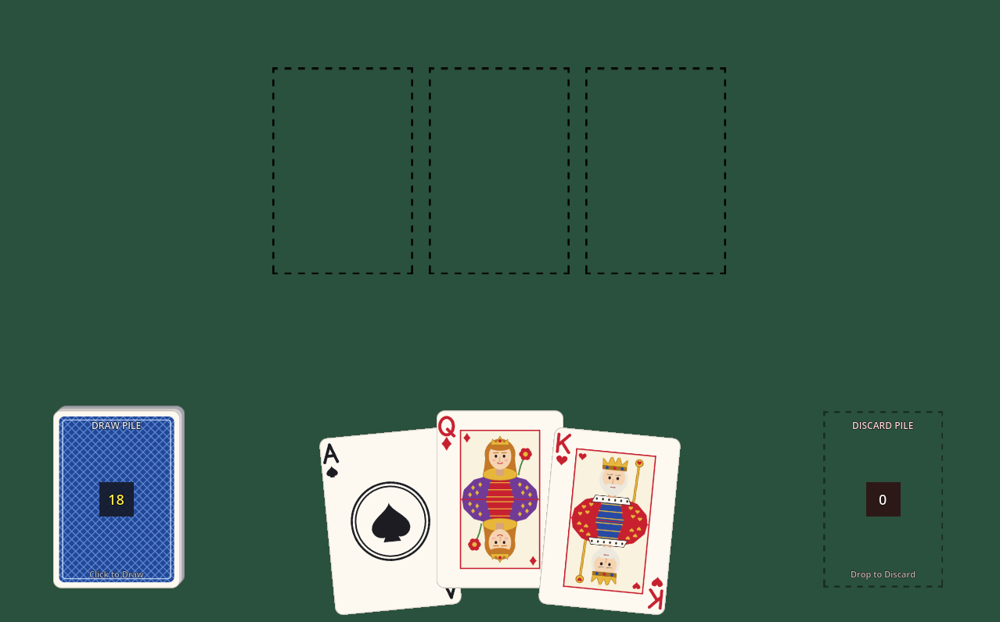
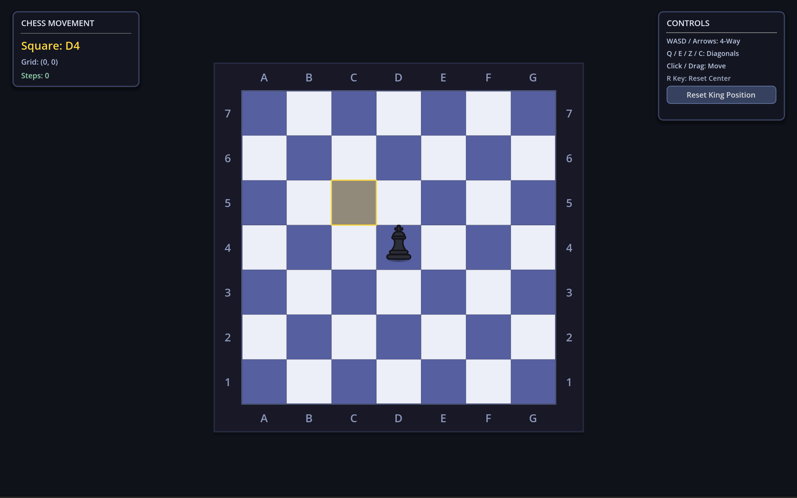

# Godot Game Systems

Reusable gameplay systems for **Godot 4.7+**, each built as a self-contained prototype you can play in the browser and dissect in the code.

---

## Systems

| System | Playable Demo | Blog Article | Source |
| :--- | :--- | :--- | :--- |
| **Card System** | [Play in Browser](https://godot-game-systems.mathusan.me/card-system/) | [Curved Hand & Card System](https://mathusan.me/blog/godot-card-system-curved-hand/) | [`card-system/`](./card-system) |
| **Chess Movement System** | [Play in Browser](https://godot-game-systems.mathusan.me/chess-movement-system/) | [Expandable Chessboard & King](https://mathusan.me/blog/godot-expandable-chessboard-king/) | [`chess-movement-system/`](./chess-movement-system) |

---

## Prototypes

### 1. [Card System](./card-system)
A deckbuilder-style card interaction framework built on a standard 52-card deck.



- **Curved Hand Layout:** Dynamic card spacing and fanned rotation along an arc.
- **Drag & Reorder:** Smoothly reorder up to 8 cards in hand or drop them onto table slots.
- **Slot Docking:** Snap cards to board slots, swap occupied slots, or return cards to the hand.
- **Deck Cycle:** Draw pile and discard pile loop with animated transitions.

### 2. [Chess Movement System](./chess-movement-system)
An expandable 8-way King grid navigation prototype with dynamic board framing and tactile juice.



- **8-Way Grid Navigation:** Cardinal and diagonal King movement via keyboard or point-and-click.
- **Procedural Board Resizing:** Seamless expansion and shrink hysteresis (`7×7` to `17×17`) with perimeter tile fades.
- **Adaptive Camera Framing:** Dynamic zoom that keeps the entire board framed within a `16:10` aspect ratio.
- **Tactile Feedback:** Elastic boundary recoil, landing dust particles, and live algebraic chess notation.

---

## Running Locally

Each folder is an independent Godot project.

1. Clone the repository:
   ```bash
   git clone https://github.com/mathusanm6/godot-game-systems.git
   ```
2. Open **Godot 4.7+** and import either [`card-system/project.godot`](./card-system/project.godot) or [`chess-movement-system/project.godot`](./chess-movement-system/project.godot).
3. Press **F5** to run the prototype.
